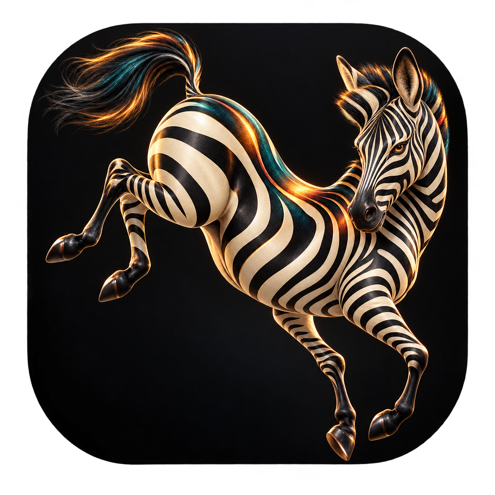
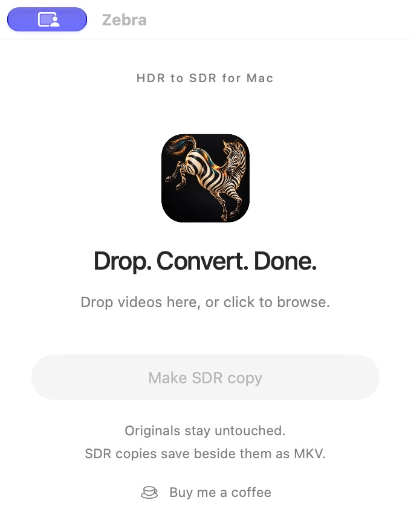

# Zebra

**Wild color. Tamed.**



[Website](https://barryanders.github.io/zebra/) · [Download preview](https://github.com/barryanders/zebra/releases/tag/v0.2.0)

Previously called Daylight.

A small native Mac app for making SDR copies of HDR videos. No encoding settings,
accounts, uploads, subscriptions, or AI services. Drop a video, click **Make SDR
copy**, and let Zebra work locally.

> Early preview. HDR10 and HLG are supported. Dolby Vision is deliberately
> rejected until profile-aware conversion is implemented and tested.

## Screenshots



## What it does

- Queues local files in a compact SwiftUI window.
- Tone-maps HDR10/PQ and HLG BT.2020 video to Rec.709 SDR.
- Preserves the original dimensions and copies audio, subtitles, chapters, and
  attachments into a new Matroska (`.mkv`) file.
- Uses Apple's hardware HEVC encoder with 10-bit output and automatic bitrate.
- Checks duration, dimensions, stream counts, SDR tags and HDR side data, then
  decodes video/audio to check for errors before making the output available.
- Saves `Example SDR.mkv` beside `Example.mkv`. Existing names receive a number.
- Never modifies or deletes the source. Cancellation removes the current partial.

Video processing makes no network requests. The optional **Buy me a coffee** link
opens your browser only when clicked. FFmpeg is invoked as a separate local
process with argument arrays, not shell commands.

## Install

Requires macOS 14 or later. Apple Silicon is the tested platform. Intel Macs need
an Intel build and working HEVC VideoToolbox encoding; Intel has not been tested.

1. Install [Homebrew](https://brew.sh), if needed, then:

   ```sh
   brew install ffmpeg-full
   ```

   Zebra finds the keg-only `ffmpeg-full` without changing your PATH. A standard
   FFmpeg installation also works if it includes `zscale`, `tonemap`, and
   `hevc_videotoolbox`. Missing capabilities produce an actionable message.

2. Download the Apple Silicon app ZIP from [Releases](https://github.com/barryanders/zebra/releases), unzip it, and move Zebra to Applications.
3. Open Zebra and add videos.

Preview builds are ad-hoc signed, **not Developer ID signed or notarized**.
macOS may block a downloaded build; follow Apple's per-app **Privacy & Security →
Open Anyway** flow only after verifying the source. Alternatively, build locally.
Do not disable Gatekeeper globally.

MKV retains tracks that MP4 cannot carry, but QuickTime does not natively play it.
Use a player with MKV and HEVC support, such as IINA or VLC.

## Build from source

Install Xcode (or a compatible Swift toolchain with the macOS SDK), then:

```sh
git clone https://github.com/barryanders/zebra.git
cd zebra
swift test --build-system native
./scripts/build-app.sh
open "dist/Zebra.app"
```

The build script creates an app and architecture-specific ZIP under `dist/`.
FFmpeg is **not bundled**. Install it separately as described above.

To exercise real PQ/HLG conversions, subtitle/audio preservation, source
preservation, collision handling and SDR rejection with generated one-second
fixtures:

```sh
DAYLIGHT_INTEGRATION=1 swift test --build-system native --filter testGeneratedHDRConversion
```

## Automatic quality policy

There are no quality controls. Zebra preserves dimensions and uses Hable tone
mapping, 10-bit HEVC, and a source-informed target bitrate:

- 4K-class video (width ≥ 2500 or height > 1200): 1.25× source bitrate, bounded to 6–12 Mbps.
- Smaller video: 1.5× source bitrate, bounded to 1.5–5 Mbps.
- When video bitrate is unavailable, the container bitrate is used, then a fallback.

This is a practical starting policy, **not a promise of visually lossless output**.
HDR-to-SDR necessarily changes highlight range and color presentation. Grain,
fast motion, dark gradients and very bright scenes still need human evaluation.
Generated-media tests verify the pipeline, not artistic fidelity.

## Current limits

- Only one video stream per input; multiple video streams and cover-art video
  streams are rejected rather than silently discarded.
- Only recognized BT.2020 non-constant-luminance PQ/HLG inputs are accepted.
- Dolby Vision, missing/ambiguous HDR metadata, odd frame dimensions, folders and
  aliases are rejected. Already-SDR input is not re-encoded.
- Unsupported copied audio/subtitle formats fail safely; they are never silently
  transcoded or dropped. Data streams are not copied.
- Conversion queues are in memory. Closing the app does not save a queue.
- Force-quitting or power loss can leave a hidden `.daylight-*.mkv` partial beside
  the source. The next run does not treat it as a completed output.
- Verification adds time after encoding. Originals must remain available and the
  destination must have enough free space.
- Source-built Intel support and broad real-world HDR visual QA remain unverified.

## Contributing

Small, tested improvements are welcome. Keep the default experience free of
encoding choices. For bugs, include macOS and FFmpeg versions and a redacted
`ffprobe` summary; do not upload private videos or personal paths. Run unit tests
and, when changing conversion behavior, the integration test on a Mac with HEVC
hardware encoding. Explain any changes to output appearance or stream handling.

## License and dependencies

Zebra source is MIT licensed. SwiftUI, AppKit, and VideoToolbox are Apple system
frameworks. FFmpeg is a separately installed executable, not copied into releases.
FFmpeg and its enabled libraries have their own licenses; see
[FFmpeg legal information](https://ffmpeg.org/legal.html). Homebrew's `ffmpeg-full`
currently identifies its build as GPL-3.0-or-later. Anyone redistributing FFmpeg
binaries must independently satisfy the applicable source and notice obligations.

## Support

[Buy me a coffee](https://buymeacoffee.com/barryanders). Support is optional;
the app remains free. The same link is available in the window and Help menu.
